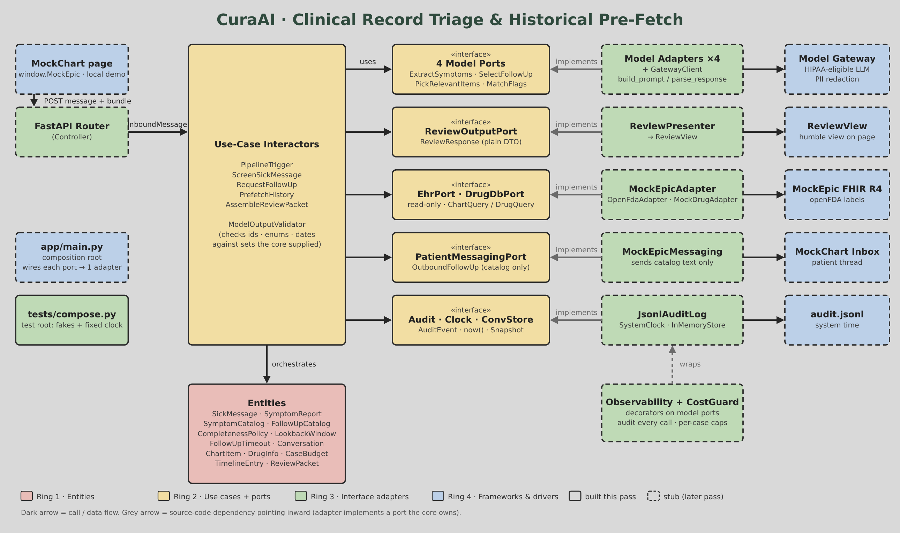

# CuraAI

CuraAI is a healthcare AI agent designed to alleviate the heavy administrative burden on physicians, who spend an estimated 5.8 hours per shift manually navigating Electronic Health Records (EHR) to cross-reference patient data. Integrated with existing systems like Epic, CuraAI screens inbound patient sick messages for missing clinical details, prompts patients for clarification, and aggregates relevant three-week historical chart data alongside pharmaceutical database information. To eliminate the risk of dangerous AI hallucinations, the system presents exact documented findings verbatim rather than generating narrative summaries. Built using a clean ports-and-adapters architecture in Python (FastAPI), CuraAI separates pure business rules from external I/O. Its core use case is Clinical Record Triage and Historical Pre-Fetch ensuring that human clinicians remain in complete control of all clinical decisions and patient communications. Key architectural choices have been formalized through project ADRs: ADR-001 routes queries through a HIPAA-eligible cloud provider behind an internal model gateway for PII redaction and logging; ADR-002 enforces a deterministic chart pull while limiting the LLM to screening and validated symptom lookups; ADR-003 establishes the Python/FastAPI ports-and-adapters foundation with an append-only PostgreSQL audit log; and  ADR-004 mandates the verbatim display of source records on a symptom-onset timeline to guarantee safety, compliance, and effortless physician verification.

**Clinical Record Triage and Historical Pre-Fetch**, CS302 Team Tokenizer.

When a patient sends a sick message, CuraAI checks that it says **when symptoms
started** and **whether they are getting better, worse or staying the same**. If
either detail is missing, it asks the patient a clinician-approved follow-up
question. Once both are known, it pulls three weeks of chart history and drug
information for the physician, shown **verbatim** with a source on every row.
The physician makes every clinical decision.



## Status

| Ring | Package | This pass |
|---|---|---|
| 1 Entities | `src/curaai/domain` | **Built and tested** |
| 2 Use cases, ports, DTOs | `src/curaai/application` | **Built and tested** |
| 3 Interface adapters | `src/curaai/adapters` | Stubs (signatures fixed, bodies raise `NotImplementedError`) |
| 4 Frameworks, composition root | `src/curaai/app` | Stub (wiring order documented in `main.py`) |

## Quick start

Requires **Python 3.12+**. Rings 1–2 have no third-party dependencies.

```bash
python -m venv .venv
source .venv/bin/activate            # Windows: .venv\Scripts\activate
pip install -e ".[dev]"
pytest                               # unit tests, all offline, fixed clock, fakes only
lint-imports                         # Dependency Rule contracts (pyproject.toml)
```

No environment variables are needed for the tests. `.env.example` lists what
`app/main.py` will read once Ring 4 is built. Never commit a real `.env`.

## Layout

```
src/curaai/
  domain/                 Ring 1, standard library only
    values.py             ids + enums (Trend, Origin, ChartItemKind, MissingField, Flag)
    symptom_catalog.py    fixed symptom ids the model must choose from        (DRAFT)
    follow_up_catalog.py  the only questions CuraAI may send a patient         (DRAFT)
    completeness.py       onset + trend present?
    lookback.py           onset - 21 days .. today
    follow_up_timeout.py  24 hours
    case_budget.py        per-case caps: 6 model calls, 5 lookups, 2 follow-ups, $0.25
    sick_message.py, symptom_report.py, chart_item.py, drug_info.py
    conversation.py       case state machine
    timeline.py           TimelineEntry, ReviewPacket
  application/            Ring 2, imports only domain
    dto/                  one module per boundary (M2 "Crossing of Each Line")
    ports/                abstract interfaces this ring owns
    validation/           ModelOutputValidator
    mapping.py            DTO <-> entity mappers (pure)
    use_cases/            PipelineTrigger, ScreenSickMessage, RequestFollowUp,
                          PrefetchHistory, AssembleReviewPacket
  adapters/               Ring 3 stubs: model, ehr, drug, presenters, persistence,
                          clock, observability, web
  app/main.py             Ring 4 composition root stub
tests/
  compose.py              test composition root (fakes + fixed clock)
  fakes/                  fake EHR, drug DB, 4 model ports, messaging, stores, clock
  fixtures/mockchart.py   synthetic MockChart patients (no real PHI)
  unit/                   domain, application, dependency-rule tests
```

## How a message flows

1. **PipelineTrigger** runs on every patient message. There is no model gate.
2. **ScreenSickMessage** sends only the patient's words to `ExtractSymptomsPort`.
   `ModelOutputValidator` rejects any symptom id outside the catalog, any trend
   outside the enum, and any onset after the message or more than a year old.
3. If onset or trend is missing, **RequestFollowUp** sends one catalog question
   that asks only for what is missing. The model may choose which question,
   never the wording. At most 2 follow-ups per case.
4. Once complete, **PrefetchHistory** runs the fixed pull:
   - medication changes, labs and visits from onset − 21 days through today
   - the current medication list
   - drug-database text for every medication changed in the window

   Optional AI help comes next. The model sees only item ids and short labels.
   It can mark relevant rows, flag medications, and add up to 5 extra drug
   lookups, which go in a separately labeled section.
5. **AssembleReviewPacket** builds the packet and passes a plain DTO to
   `ReviewOutputPort`. The presenter, not built yet, formats it.

If the model fails, goes over its cap, or gives an answer the validator
rejects, AI switches off for that case and the fixed pull still runs.

## Decisions made in this pass

These came from team Q&A on 2026-10-26, or from gaps in the briefs. Review them at the next meeting.

- **Lookback window ends today, not at onset.** Results after onset, like a same-day troponin, are included.
- **24-hour timeout hands off messages only.** No chart pull runs. Running out of follow-ups is handled the same way.
- **The AI fallback still runs the fixed pull** (ADR-011). When onset is unknown, the window is anchored to the first message date, and the packet says so (`incomplete_reason = ai_unavailable`).
- **One bad extraction switches AI off for the case.** A rejected extraction is never partly used. A rejected follow-up choice just falls back to the catalog's default question.
- **`ChartItemRecord` is the DTO name.** The M2 table calls the EHR DTO `ChartItem`, which clashes with the Ring 1 entity. This mirrors the existing `DrugRecord` / `DrugInfo` pair.
- **Current medications are always pulled,** as well as changes inside the window, so interactions can be checked.
- **Records that fail a check are dropped, audited and counted.** This covers records with no source and records outside the window. The physician sees `rejected_item_count`.
- **Rings 1–2 use frozen standard-library dataclasses.** Pydantic is only for the FastAPI edge (Ring 3/4).

## Open questions for the team

1. **Urgent symptoms.** Nothing in the briefs fast-tracks something like chest pain radiating to the arm (MockChart patient p5). Today that message would be screened like any other. Do we need a red-flag rule that skips follow-ups and alerts the physician right away?
2. **Catalog sign-off.** Both catalogs are drafts and need a clinician to approve them (ADR-009).
3. **A message that arrives while a case is being processed** opens a new case. Is that acceptable?

## Next pass (Ring 3 → Ring 4)

`fhir_to_chart_items` mapper → `MockEpicAdapter` → `MockDrugAdapter` / `OpenFdaAdapter`
→ `ReviewPresenter` → `JsonlAuditLog` / `InMemoryConversationStore` → model
adapters + `GatewayClient` + logging/CostGuard decorators → FastAPI router →
`app/main.py` → the MockChart page bridge.
