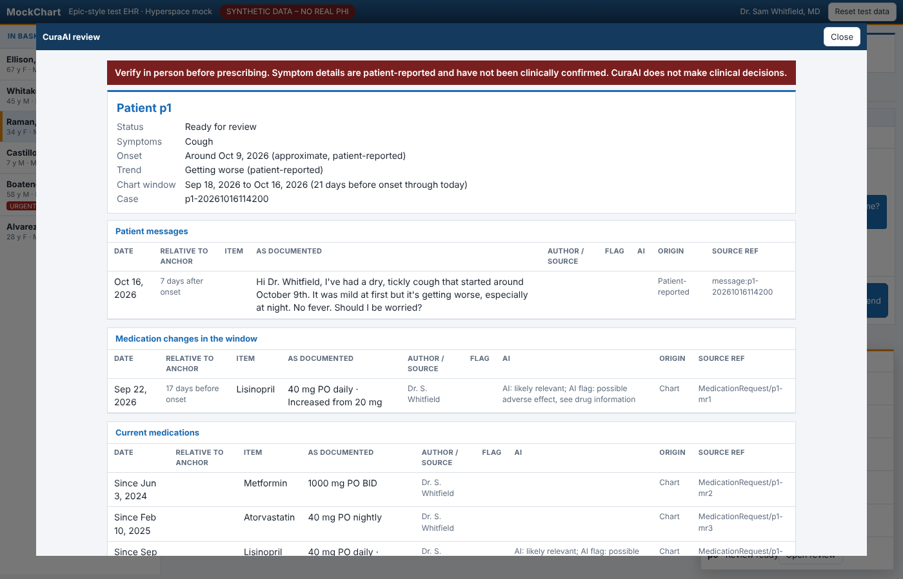
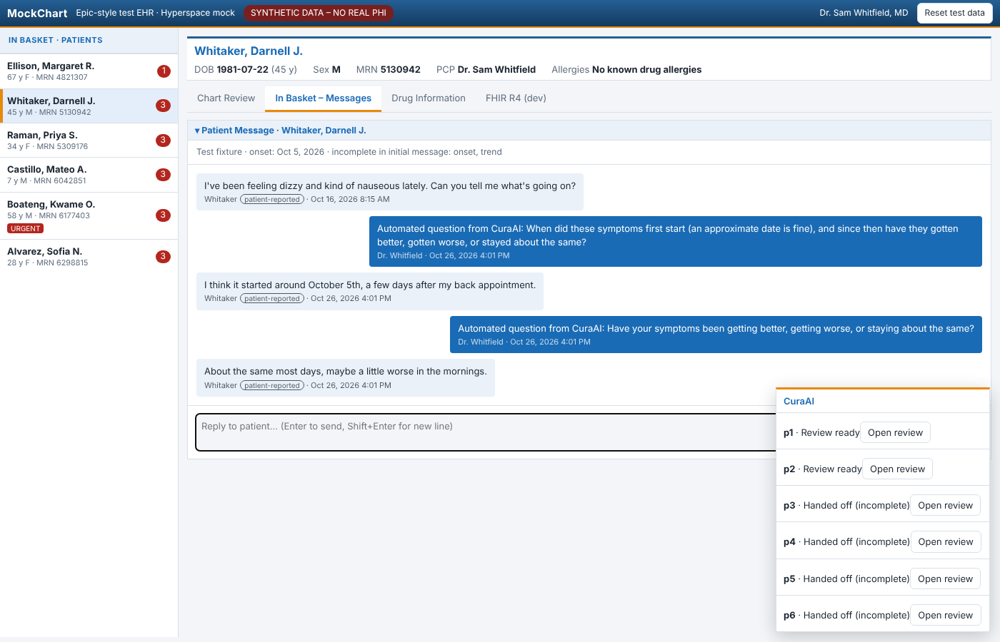
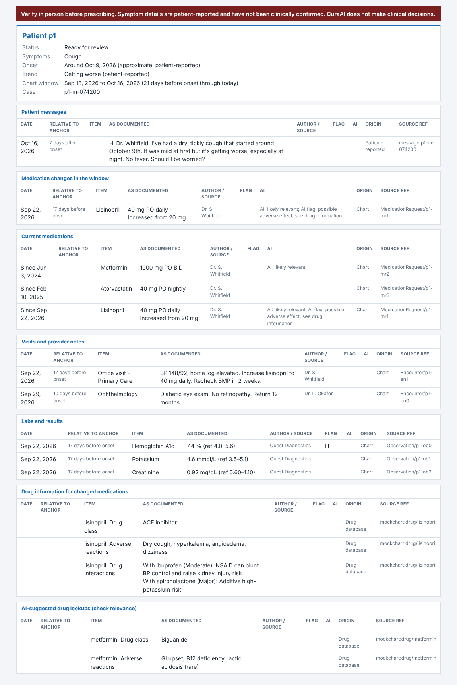

# CuraAI

CuraAI is a healthcare AI agent designed to alleviate the heavy administrative burden on physicians, who spend an estimated 5.8 hours per shift manually navigating Electronic Health Records (EHR) to cross-reference patient data. Integrated with existing systems like Epic, CuraAI screens inbound patient sick messages for missing clinical details, prompts patients for clarification, and aggregates relevant three-week historical chart data alongside pharmaceutical database information. To eliminate the risk of dangerous AI hallucinations, the system presents exact documented findings verbatim rather than generating narrative summaries. Built using a clean ports-and-adapters architecture in Python (FastAPI), CuraAI separates pure business rules from external I/O. Its core use case is Clinical Record Triage and Historical Pre-Fetch ensuring that human clinicians remain in complete control of all clinical decisions and patient communications. Key architectural choices have been formalized through project ADRs: ADR-001 routes queries through a HIPAA-eligible cloud provider behind an internal model gateway for PII redaction and logging; ADR-002 enforces a deterministic chart pull while limiting the LLM to screening and validated symptom lookups; ADR-003 establishes the Python/FastAPI ports-and-adapters foundation with an append-only PostgreSQL audit log; and  ADR-004 mandates the verbatim display of source records on a symptom-onset timeline to guarantee safety, compliance, and effortless physician verification.

**Clinical Record Triage and Historical Pre-Fetch**, CS302 Team Tokenizer.

When a patient sends a sick message, CuraAI checks that it says **when symptoms
started** and **whether they are getting better, worse or staying the same**. If
either detail is missing, it asks the patient a clinician-approved follow-up
question. Once both are known, it pulls three weeks of chart history and drug
information for the physician, shown **verbatim** with a source on every row.
The physician makes every clinical decision.


## Status

| Ring | Package | This pass |
|---|---|---|
| 1 Entities | `src/curaai/domain` | **Built and tested** |
| 2 Use cases, ports, DTOs | `src/curaai/application` | **Built and tested** |
| 3 Interface adapters | `src/curaai/adapters` | **Built and tested**: EHR (`MockEpicAdapter`), drug DB (`MockDrugAdapter`, `OpenFdaAdapter`), model (`ModelGateway`, Bedrock transport, `CostGuard`, four adapters), observability, presenter, persistence, web controller + FastAPI routes + page bridge |
| 4 Frameworks, composition root | `src/curaai/app/main.py` | **Built**: `Config.from_env`, `build_container`, `build_app`, Uvicorn |

## Quick start

Requires **Python 3.12+**. Rings 1–2 have no third-party dependencies.

```bash
python -m venv .venv
source .venv/bin/activate            # Windows: .venv\Scripts\activate
pip install -e ".[dev]"
pytest                               # unit tests, all offline, fixed clock, fakes only
lint-imports                         # Dependency Rule contracts (pyproject.toml)
```

No environment variables are needed for the tests. The FastAPI route test is skipped
unless the `web` extra is installed (`pip install -e ".[dev,web]"`).

## Run the demo with MockChart

No cloud account is needed. By default CuraAI uses its **local reader**
(`CURAAI_MODEL_BACKEND=local`), a rule-based stand-in for the AI model that runs on your machine.
It reads each patient message (symptoms, when they started, getting better or worse), asks
follow-up questions for anything missing, then pulls the 3-week chart window measured from
the onset and flags medications whose known side effects match the symptoms.

```bash
pip install -e ".[web]"
cp .env.example .env                 # Windows: copy .env.example .env
python -m curaai.app.main
```

Then open **http://127.0.0.1:8000/mockchart**. The backend serves the team's MockChart
page with a small bridge script added (the HTML file itself is never edited). The bridge:

1. sends every patient message, with that patient's FHIR bundle, to CuraAI,
2. delivers CuraAI's follow-up questions into the patient's thread, where MockChart's
   simulated patient answers them,
3. shows a **CuraAI** panel (bottom right) with an **Open review** button per patient.

### If the demo isn't working

Run the setup check first, from the CuraAI folder:

```bash
python -m curaai.app.check
```

It shows what your `.env` actually selects (API keys hidden), whether the settings are valid,
whether port 8000 is already taken, whether the MockChart page was found and, for Gemini,
makes one tiny test call so a bad key shows up immediately.

| What you see | What it means | Fix |
|---|---|---|
| Panel says **"Can't reach the CuraAI server"** | The server isn't running, or it stopped | Start `python -m curaai.app.main` again; the panel reconnects by itself |
| Server says **"something is already running on 127.0.0.1:8000"** | An old CuraAI server is still open | Close that PowerShell window (or Ctrl+C in it), then start again |
| Server says **"CuraAI can't start: …"** | A setting in `.env` is wrong (e.g. Gemini chosen but no key) | Run the setup check; it names the setting |
| Reviews say **"AI screening was unavailable"** | Reading the message failed for that case: backend set to `none`, Gemini refused the call (bad key, per-minute limit, no internet), or Gemini's answer failed the safety check | Run the setup check, then see the exact reason in the audit log (command below) |
| Want to run the patients again | | Click **Re-run** in the CuraAI panel, or MockChart's **Reset test data** |

To see why a case fell back, show the last few failures from the audit log (PowerShell, in the CuraAI folder):

```powershell
Select-String -Path audit.jsonl -Pattern 'model_gateway_error|model_output_rejected|cost_guard_tripped' | Select-Object -Last 3
```

`model_gateway_error` lines include the model service's own message (e.g. `Gemini HTTP 429: quota exceeded`
or `Gemini HTTP 400: API key not valid`). `model_output_rejected` lines give the safety check's reason.
Gemini's per-minute limit is retried automatically (up to 3 tries, waiting as long as Google asks).

### Use a real AI model: Google Gemini

1. Sign in at **https://aistudio.google.com/apikey** with a Google account and click **Create API key**.
   Each teammate can make their own free key; don't share keys in chat.
2. Open your `.env` file (copy it from `.env.example` if you haven't) and set:
   ```
   CURAAI_MODEL_BACKEND=gemini
   CURAAI_GEMINI_API_KEY=paste-your-key-here
   ```
   `.env` is in `.gitignore`, so the key is never committed. Optional: `CURAAI_GEMINI_MODEL`
   (default `gemini-3.8-flash`) and `CURAAI_GEMINI_THINKING_LEVEL` (default `low`).
3. Run `python -m curaai.app.main`. The first line should say `model=gemini (gemini-3.8-flash)`.

To check it is really Gemini: in `audit.jsonl`, the `model_gateway_call` lines show
`"model": "gemini-…"` with token counts and a cost. If Gemini fails (bad key, quota, no internet),
the review says *"AI screening was unavailable"* and the line is a `model_gateway_error`.

**Synthetic data only.** A Google AI Studio key is fine for MockChart's fake patients. Real
patient data would need Gemini on Vertex AI under a Google Cloud BAA, which is a separate
decision (ADR-001, ADR-006).

AWS Bedrock is also supported: `CURAAI_MODEL_BACKEND=bedrock`, `CURAAI_BEDROCK_MODEL_ID`, and
`pip install -e ".[web,bedrock]"`.




Never commit a real `.env`.

## Layout

```
src/curaai/
  domain/                 Ring 1, standard library only
    values.py             ids + enums (Trend, Origin, ChartItemKind, MissingField, Flag)
    symptom_catalog.py    fixed symptom ids the model must choose from        (DRAFT)
    follow_up_catalog.py  the only questions CuraAI may send a patient         (DRAFT)
    completeness.py       onset + trend present?
    lookback.py           onset - 21 days .. today
    follow_up_timeout.py  24 hours
    case_budget.py        per-case caps: 6 model calls, 5 lookups, 2 follow-ups, $0.25
    sick_message.py, symptom_report.py, chart_item.py, drug_info.py
    conversation.py       case state machine
    timeline.py           TimelineEntry, ReviewPacket
  application/            Ring 2, imports only domain
    dto/                  one module per boundary (M2 "Crossing of Each Line")
    ports/                abstract interfaces this ring owns
    validation/           ModelOutputValidator
    mapping.py            DTO <-> entity mappers (pure)
    use_cases/            PipelineTrigger, ScreenSickMessage, RequestFollowUp,
                          PrefetchHistory, AssembleReviewPacket
  adapters/               Ring 3 stubs: model, ehr, drug, presenters, persistence,
                          clock, observability, web
  app/main.py             Ring 4 composition root stub
tests/
  compose.py              test composition root (fakes + fixed clock)
  fakes/                  fake EHR, drug DB, 4 model ports, messaging, stores, clock
  fixtures/mockchart.py   synthetic MockChart patients (no real PHI)
  fixtures/fhir/          FHIR bundles captured from the real MockChart page (+ capture.py)
  fixtures/openfda/       openFDA-shaped response with SYNTHETIC label text (+ capture.py for a real one)
  unit/                   domain, application, dependency-rule tests
```

## How a message flows

1. **PipelineTrigger** runs on every patient message. There is no model gate.
2. **ScreenSickMessage** sends only the patient's words to `ExtractSymptomsPort`.
   `ModelOutputValidator` rejects any symptom id outside the catalog, any trend
   outside the enum, and any onset after the message or more than a year old.
3. If onset or trend is missing, **RequestFollowUp** sends one catalog question
   that asks only for what is missing. The model may choose which question,
   never the wording. At most 2 follow-ups per case.
4. Once complete, **PrefetchHistory** runs the fixed pull:
   - medication changes, labs and visits from onset − 21 days through today
   - the current medication list
   - drug-database text for every medication changed in the window

   Optional AI help comes next. The model sees only item ids and short labels.
   It can mark relevant rows, flag medications, and add up to 5 extra drug
   lookups, which go in a separately labeled section.
5. **AssembleReviewPacket** builds the packet and passes a plain DTO to
   `ReviewOutputPort`. **ReviewPresenter** turns it into a `ReviewView` of
   display-ready strings. The view only loops, escapes and fills slots.

Example of the physician's screen (synthetic MockChart patient):
[`docs/samples/ellison_review.html`](docs/samples/ellison_review.html)



If the model fails, goes over its cap, or gives an answer the validator
rejects, AI switches off for that case and the fixed pull still runs.

## Decisions made in this pass

These came from team Q&A on 2026-10-26, or from gaps in the briefs. Review them at the next meeting.

- **Lookback window ends today, not at onset.** Results after onset, like a same-day troponin, are included.
- **24-hour timeout hands off messages only.** No chart pull runs. Running out of follow-ups is handled the same way.
- **The AI fallback still runs the fixed pull** (ADR-011). When onset is unknown, the window is anchored to the first message date, and the packet says so (`incomplete_reason = ai_unavailable`).
- **One bad extraction switches AI off for the case.** A rejected extraction is never partly used. A rejected follow-up choice just falls back to the catalog's default question.
- **`ChartItemRecord` is the DTO name.** The M2 table calls the EHR DTO `ChartItem`, which clashes with the Ring 1 entity. This mirrors the existing `DrugRecord` / `DrugInfo` pair.
- **Current medications are always pulled,** as well as changes inside the window, so interactions can be checked.
- **Records that fail a check are dropped, audited and counted.** This covers records with no source and records outside the window. The physician sees `rejected_item_count`.
- **Stopped medications carry a `stopped` flag.** MockChart's FHIR marks a discontinued med `status: "stopped"` but gives no end date. A stopped med is never treated as current. Because its stop date is unknown, it doesn't count as a change in the window either; the new dose's own row shows the change. This is one of the gaps ADR-005 says to watch for, and real Epic data should give end dates.
- **The FHIR mapper never hides a bad record.** A resource with no `id` gets an empty `source_ref`, so the core rejects it and counts it. Other patients' resources and `entered-in-error` entries are dropped at the adapter.
- **Drug records carry the boxed warning and contraindications**, as well as class, adverse reactions and interactions. A boxed warning is listed first.
- **openFDA text is never truncated.** The MockChart page trims labels to 900 characters for display; the backend keeps the whole label, and the presenter decides layout.
- **openFDA must match the drug name exactly** (generic or brand). Phrase search also returns combination products, so a near miss counts as "not found". Chart names like "Albuterol HFA" are searched as written; mapping them to canonical names is terminology work (deferred).
- **The mock drug list is captured from the page** (`adapters/drug/mockchart_drugs.json`), including its interaction table, so the backend and the page agree.
- **The presenter owns every display choice.** It fixes the section order; rows run chronologically against onset; and it does the date and offset wording ("17 days before onset"), the "Patient-reported" labels, the approximate-onset wording and the always-on banner. It also writes the notices for incomplete cases, the AI fallback and withheld records. It never edits row text. Current medications show "Since <date>" without an offset.
- **The review packet records the window it searched**, so the doctor sees the exact range rather than the presenter recomputing a business rule.
- **The audit log is an append-only JSONL file for the prototype** (Postgres later, ADR-017). One JSON line per event, flushed and fsync'd, with a schema version; there is no update or delete. Patient message text is never written to it, only ids, counts and reasons.
- **Open cases are kept in memory.** A restart loses open cases and their 24-hour timers. The trigger for building a database-backed store is "the timeout must survive a restart".
- **The model gateway runs in-process for now** (ADR-001). It does the PII redaction, prompt versioning, pricing and audit, and hands off to a swappable vendor transport. Bedrock's Converse API is the first transport. The boto3 client is built only in `app/main.py`, so nothing else imports a vendor SDK.
- **Redaction removes** emails, phone numbers, SSNs, URLs and 6+ digit IDs (MRNs) before anything leaves. It **keeps** dates and doses, which the model has to read. Names are not removed yet: that needs an NER model, and it is a gate before any real PHI (ADR-006).
- **Parsers don't judge values.** A prompt parser only refuses text that isn't a JSON object. Wrong types, unknown ids and injected text pass through to the core's `ModelOutputValidator`, so every rejection is decided and audited in one place.
- **`CostGuard` lives in `adapters/model`**, not observability, because it wraps `GatewayClient` and adapter packages never import each other. It enforces the per-case dollar cap and a daily budget. Ring 2 already enforces the call, lookup and follow-up caps. Tripping on a spike in failed validations is deferred until the evaluation run gives a threshold.
- **Metrics come from the audit log** (`case_metrics`, ADR-008), so the numbers can never disagree with what auditors see.
- **Model-call cap doubled from 6 to 12 per case** (team decision, 2026-10-26). In the MockChart run, a two-follow-up case used all 6 and lost medication flagging; with 12 the same case uses 7 and keeps it. The lookup, follow-up and $0.25 caps are still the ADR-011 proposals. Record this as an amendment to ADR-011.
- **The web layer is split for testing.** `WebController` makes every HTTP decision (request checks, status codes, response shapes) with no framework imported. The FastAPI routes each make one call to it. Collaborators are injected as small Protocols, so the web package imports no other adapter.
- **The backend serves MockChart at `/mockchart` with the bridge added**, so the page and API share an origin (no CORS) and the team's HTML file stays untouched. The raw FHIR bundle stops at the EHR adapter's bundle source.
- **Follow-up questions reach the page through an outbox** that the bridge polls.
- **Every follow-up is labeled as automated** (team decision, 2026-10-26). `OutboundFollowUp.sender_label` is required and set by the core from `AUTOMATED_SENDER_LABEL` ("Automated question from CuraAI"), so no adapter can drop it. MockChart can only post as the doctor, so the label goes in front of the unchanged catalog text. A real Epic adapter should use Epic's own sender or automation field.
- **The demo's default reader is `local`**, a rule-based backend (`adapters/model/local_rules.py`). Without it, a demo with no AWS account never read the patient's message, so the chart window was measured from the message date. That missed the history that matters: Ellison's lisinopril increase 17 days before her cough, and Raman's levothyroxine increase.
  - The local reader plugs in exactly where Bedrock does. Its answers go through the same gateway, audit log and core validator, and it sees only patient words, ids and short labels.
  - It is **not** the product's model; ADR-002 rejected rule-based screening for production. It's a demo stand-in and a deterministic baseline for the evaluation set (ADR-016).
  - Its side-effect table is demo knowledge from MockChart's synthetic drug list.
  - Known wording gap: review tags still say "AI" ("AI: likely relevant") even when the local reader produced them.
- **Google Gemini is a supported model backend** (`CURAAI_MODEL_BACKEND=gemini`, `adapters/model/gemini_transport.py`), requested by the team so the agent runs on a real model.
  - It uses Gemini's `generateContent` REST API with the standard library only, so there's no extra package to install. The key goes in the `x-goog-api-key` header, never the URL, and never reaches logs or the settings printout.
  - It requests JSON-only answers and a `low` thinking level, with an output allowance high enough that thinking can't cut an answer off.
  - Like Bedrock, it plugs into the same gateway (redaction, audit, cost caps) and the same core validator. If Gemini fails, the case falls back to the fixed chart pull.
  - **ADR note:** ADR-001 chose a HIPAA-eligible cloud provider. A Google AI Studio key is for synthetic data only. Real PHI would need Gemini on Vertex AI under a BAA; record the vendor choice as an ADR-001 amendment.
- **The demo recovers on its own and explains problems** (fix after a team report that the panel was stuck on "Watching the In Basket…").
  - On every load, the panel asks the server for each patient's latest case, so a reload never shows an empty panel.
  - MockChart's **Reset test data** and the panel's **Re-run** button screen the patients again.
  - The panel reports when the server can't be reached.
  - The server refuses to start with a plain message when the port is taken or a setting is wrong.
  - `python -m curaai.app.check` reports the whole setup, keys hidden.
- **"AI screening was unavailable" is now explainable and less likely.**
  - The gateway logs the model service's own error message (scrubbed of identifiers), not just the error type.
  - Gemini rate limits (429) and brief outages (500/503) are retried up to 3 times, honoring Google's retry delay (capped at 30 s). Free keys have a per-minute limit, and the demo sends six patients at once.
  - Parsers normalize harmless style differences ("Cough", "chest pain", an ISO timestamp for a date, "true" as a string) before the core validator, which is still strict about values.
- **`CURAAI_MODEL_BACKEND=none` is still available.** Every model call fails cleanly and the fixed chart pull runs from the message date (the ADR-011 fallback).
- **The bridge resends after a server restart.** The server reports an instance id at `/api/health`; when it changes, the page forgets which messages it already sent. A normal reload still sends nothing twice.
- **The trend question was reworded** to "Have your symptoms been getting better, getting worse, or staying about the same?". The old wording began "Since they started…", which reads like an onset question on its own (MockChart's simulated patient answered it as one).
- **MockChart test data was re-captured** after the team added amlodipine (stopped Aug 18) and an Aug 18 visit to Ellison. The parity test caught the drift.
- **Rings 1–2 use frozen standard-library dataclasses.** Pydantic is only for the FastAPI edge (Ring 3/4).

## Open questions for the team

1. **Urgent symptoms.** Nothing in the briefs fast-tracks something like chest pain radiating to the arm (MockChart patient p5). Today that message would be screened like any other. Do we need a red-flag rule that skips follow-ups and alerts the physician right away?
2. **Catalog sign-off.** Both catalogs are drafts and need a clinician to approve them (ADR-009).
3. **A message that arrives while a case is being processed** opens a new case. Is that acceptable?

## Remaining work

All four rings are built. What's left before a pilot:

- **Real model:** choose the Bedrock model id and get pricing; build the synthetic evaluation set and run it (ADR-001, ADR-016).
- **Name redaction:** add an NER step to the gateway before any real PHI (ADR-006).
- **Persistence:** a database-backed conversation store so the 24-hour timeout survives restarts, and the Postgres audit store (ADR-017).
- **Real Epic:** SMART on FHIR launch and an `EpicEhrAdapter` (ADR-017).
- **Decisions:** the open questions above, starting with urgent symptoms.
